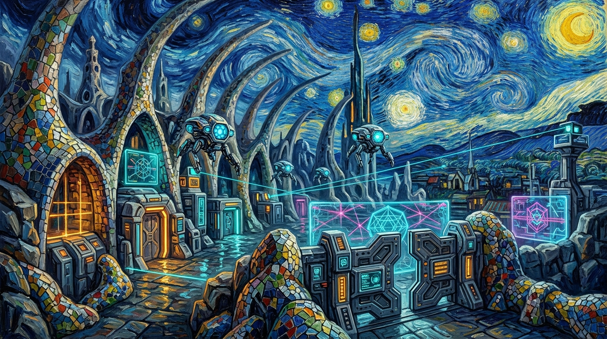

<p align="center">
  
</p>

# 🌌 NeXXuS — Sovereign Decentralized Cloud & P2P Storage Node

<p align="center">
  <strong>High-performance, sovereign peer-to-peer storage, Tor v3 communications, and private vault network written in Rust.</strong>
</p>

<p align="center">
  <a href="#-quick-start"></a>
  <a href="#-testing--verification"></a>
  <a href="#-core-architecture"></a>
  <a href="#-storage-engine"></a>
  <a href="#-network-transport"></a>
  <a href="#-audit-status"></a>
</p>

---

## 📚 Documentation & User Guides / Документация / Documentación

| Language | User Guide | Description |
| :--- | :--- | :--- |
| 🇷🇺 **Русский** | [**USER_GUIDE.ru.md**](docs/USER_GUIDE.ru.md) | Полное руководство пользователя (Архитектура, CLI, Vault, SMP, DePIN) |
| 🇬🇧 **English** | [**USER_GUIDE.en.md**](docs/USER_GUIDE.en.md) | Complete User Manual (Architecture, CLI, Vault, SMP, DePIN) |
| 🇪🇸 **Español** | [**USER_GUIDE.es.md**](docs/USER_GUIDE.es.md) | Guía Completa de Usuario (Arquitectura, CLI, Vault, SMP, DePIN) |
| 💼 **Investor** | [**INVESTOR_PRESENTATION_AND_TOKENOMICS.md**](docs/INVESTOR_PRESENTATION_AND_TOKENOMICS.md) | Презентация инвестору, 6 моделей монетизации и финансовый план |
| 📐 **Specs** | [**docs/PROTOCOL_WIRE_SPEC.md**](docs/PROTOCOL_WIRE_SPEC.md) · [**docs/NEXXUS_SPECIFICATION_V2.md**](docs/NEXXUS_SPECIFICATION_V2.md) | Спецификация бинарного wire-протокола и архитектуры v2 |
| 🛡️ **Security** | [**docs/SECURITY.md**](docs/SECURITY.md) · [**docs/THREAT_MODEL.md**](docs/THREAT_MODEL.md) | Политика безопасности и модель угроз |

---

## ⚡ What is NeXXuS?

**NeXXuS** eliminates reliance on centralized cloud monopolies (AWS, Google Cloud, Cloudflare, Dropbox, 1Password) by replacing data centers with a sovereign, peer-to-peer storage mesh running on commodity hardware.

### 🛡️ Production Core Capabilities (Implemented & Audited)

1. **Zero-Knowledge Sovereign Vault**:
   * Master secrets are derived via **BIP-39 mnemonic + PBKDF2-HMAC-SHA256 (600,000 rounds)**.
   * Encrypted client-side using **AES-256-GCM AEAD**.
   * **C-9 Fix Verified**: Cryptographic domain separation (`nexxus-vault-encryption-key-v2` vs `nexxus-vault-pin-verifier-v2`). The stored verifier in JSON is mathematically independent of the AES key.
2. **Resilient Mesh & Erasure Coding**:
   * **Reed-Solomon (4+2) over GF(2^8)**: files are chunked (16 KB), sealed, and striped across nodes. Data survives even if 2 out of 6 donor nodes are permanently lost.
   * Validated against standardized RFC and Project Golden Vectors in `nexxus-vectors/`.
3. **Embedded Transactional Engine**:
   * Storage backend powered by **Redb** (ACID transactional key-value store in Rust).
   * Storage isolation: donor host nodes only store ciphertext shards without knowing file contents, hashes, or identities.
4. **Anonymous P2P Network**:
   * Native **Tor v3 onion routing** with 56-character base32 hidden services (`.onion`).
   * **Kademlia DHT** routing with XOR distance calculations.
   * Anti-Sybil protection through calibrated Proof-of-Work (PoW).
5. **Native Daemon & Packaging**:
   * Pure native Rust binary (`nexxusd`).
   * Systemd service configured with dedicated unprivileged `nexxus` user (`ProtectSystem=full`, `PrivateTmp=true`).
   * Automated `.deb` packaging via `scripts/build-deb.sh`.

---

## 🔬 Research & Development Roadmap (Phase 3)

The following advanced cryptographic systems are currently implemented as **wire-format prototypes and simulations** in `pqc.rs` and `merkle.rs`, and are scheduled for full production implementation in Phase 3:

* **Post-Quantum Cryptography (ML-KEM-768 / Kyber-768)**: Wire-format hybrid encapsulation framework currently simulated using X25519 pairs. Scheduled for integration with NIST FIPS 203 lattice implementation in Phase 3.
* **Succinct ZK-SNARK PoR (Groth16 384B)**: 384-byte succinct proof container for Merkle tree inclusion. Scheduled for complete arithmetic circuit generation (arkworks) in Phase 3.
* **BLAKE3 & Argon2id Hashing Upgrades**: Migration from SHA-256 and PBKDF2 to memory-hard Argon2id and tree-hashing BLAKE3.
* **TON Multi-Signature Clearing**: Complete smart contract restructuring to support dynamic cell-dictionary signature aggregation for $M \ge 2$ auditor quorums.

---

## 🏗️ Repository Architecture

```text
NeXXus-Node/
├── crates/                         # Core Rust workspace (high performance & memory safety)
│   ├── nexxus-core/                # Primitives: AES-GCM, Reed-Solomon, BIP-39, SMP, Vault
│   ├── nexxus-node/                # Node daemon: CLI (nexxusd), Redb storage, RPC, P2P sync
│   └── nexxus-sdk/                 # Client library and integration bindings
├── nexxus-desktop/                 # Cross-platform desktop UI (Tauri + Vite + React)
├── contracts/                      # TON smart contracts (under refactoring for M>=2 quorum)
├── docs/                           # Centralized documentation hub
│   ├── USER_GUIDE.md               # User guide hub (RU, EN, ES)
│   ├── INVESTOR_PRESENTATION_AND_TOKENOMICS.md  # Investor deck & 3-year financial model
│   ├── PROTOCOL_WIRE_SPEC.md       # Binary protocol specification
│   ├── NEXXUS_SPECIFICATION_V2.md  # Core v2 specification
│   ├── SECURITY.md                 # Security disclosures & policy
│   └── adr/                        # Architecture Decision Records (0000–0010)
├── nexxus-vectors/                 # Cryptographic Golden Vectors (BIP-39, Tor v3, Reed-Solomon, etc.)
├── scripts/                        # CI gates, hygiene checks, deb builder (build-deb.sh)
└── test/                           # Conformance test suites
```

---

## 🚀 Quick Start

### 1. Build and Run the Node (CLI)

```bash
# Clone the repository
git clone https://github.com/PerfectFriend/NeXXUs-Node.git
cd NeXXUs-Node

# Build workspace release binaries
cargo build --release -p nexxus-node

# Run help command
./target/release/nexxusd --help

# Initialize a new Sovereign Seed Vault
./target/release/nexxusd init

# Start the node daemon
./target/release/nexxusd serve
```

### 2. Run the Desktop Application (Tauri)

```bash
cd nexxus-desktop
npm install
npm run tauri dev
```

### 3. Build Debian / Ubuntu Package (.deb)

```bash
bash scripts/build-deb.sh
sudo dpkg -i dist/nexxus-node_2.0.0_amd64.deb
```

---

## 🧪 Testing & Verification

```bash
# 1. Run all Rust workspace tests (245 tests)
cargo test --workspace

# 2. Verify C-9 Vault Key Leakage immunity
cargo test -p nexxus-core --lib keys::vault::tests::vault_file_does_not_contain_encryption_key

# 3. Compiler and strict lint check
cargo clippy --workspace --all-targets -- -D warnings

# 4. Run Golden Vector tests
npm test

# 5. Tree hygiene gate
bash scripts/check-tree-hygiene.sh
```

---

## 📄 License & Responsible Disclosure

NeXXuS is open-source software licensed under the **MIT / Apache 2.0** dual license.

* For security inquiries or vulnerability reports, please refer to [docs/SECURITY.md](docs/SECURITY.md).
